<!-- _class: lead -->
<!-- _paginate: false -->
<!-- _footer: '' -->


#  2.0

### Dynamic operability, a new NLP solver, brand new tools for design, models, and skills for coding agents

<div style="font-size:32px;margin-top:14px;line-height:1.45;">
Victor Alves<br>
Incoming Assistant Professor <br>
Postdoctoral Fellow<br>
Department of Chemical Engineering <br>
July 23, 2026
</div>


---

# Opyrability, and what is new in 2.0

<div class="columns wide-left">
<div>

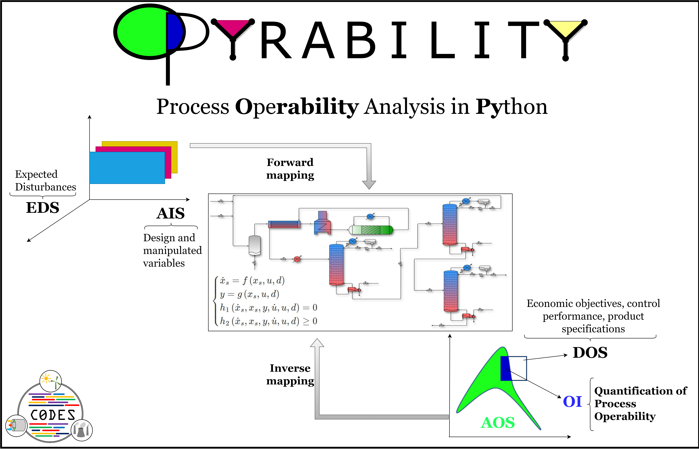

</div>
<div>

Map inputs to reachable outputs, score operability, and invert targets back to designs.

**New in 2.0**
1. **Dynamic operability**: funnels and the dynamic OI
2. **One-command install** with the Pounce solver
3. **Design tools**: ranking, MILP design, intensification
4. **Any model**: Python, Pyomo, surrogates
5. **LLM and coding agent integration**
6. **147 tests** on Python 3.11 to 3.14

</div>
</div>

---

# Adoption :)

<span class="bignum" style="font-size:58px;">37k+</span> &nbsp; <span class="sub">PyPI downloads and counting, used across the northern and southern hemispheres.</span>

<div class="columns" style="text-align:center;">
<div>

[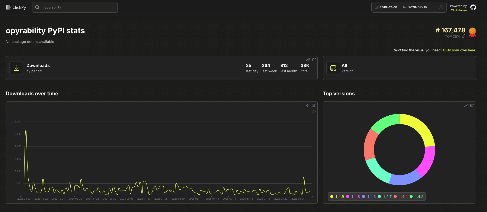](https://clickpy.clickhouse.com/dashboard/opyrability)
<div class="sub"><a href="https://clickpy.clickhouse.com/dashboard/opyrability">clickpy.clickhouse.com</a></div>

</div>
<div>

[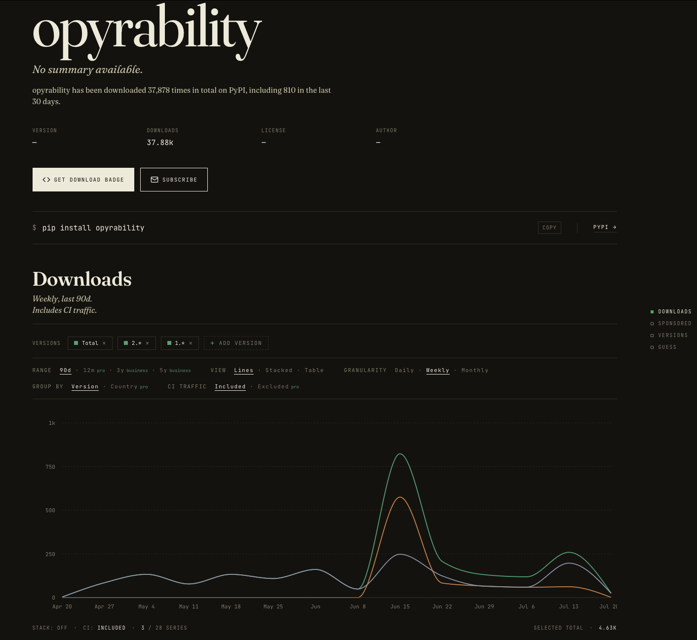](https://pepy.tech/projects/opyrability)
<div class="sub"><a href="https://pepy.tech/projects/opyrability">pepy.tech</a></div>

</div>
</div>

---

# In the wild - many different applications!

<div class="grid">
<figure>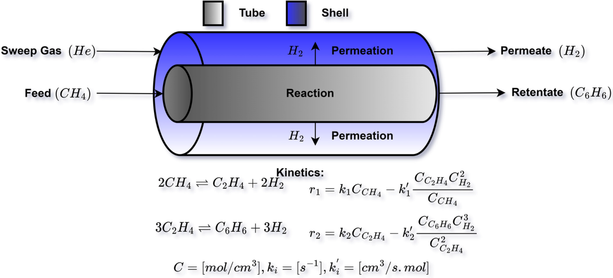<figcaption>Membrane reactor (JAX)</figcaption></figure>
<figure>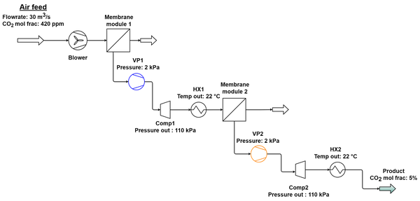<figcaption>Direct air capture (AVEVA)</figcaption></figure>
<figure>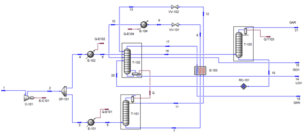<figcaption>Air separation (UniSim)</figcaption></figure>
<figure>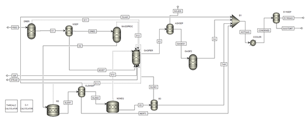<figcaption>Sludge gasification (Aspen)</figcaption></figure>
<figure>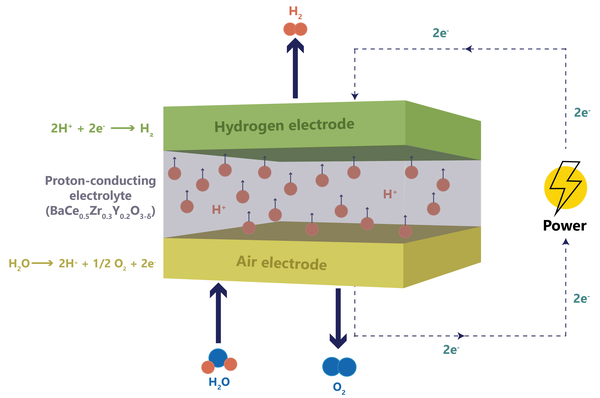<figcaption>Solid oxide electrolysis (IDAES)</figcaption></figure>
<figure>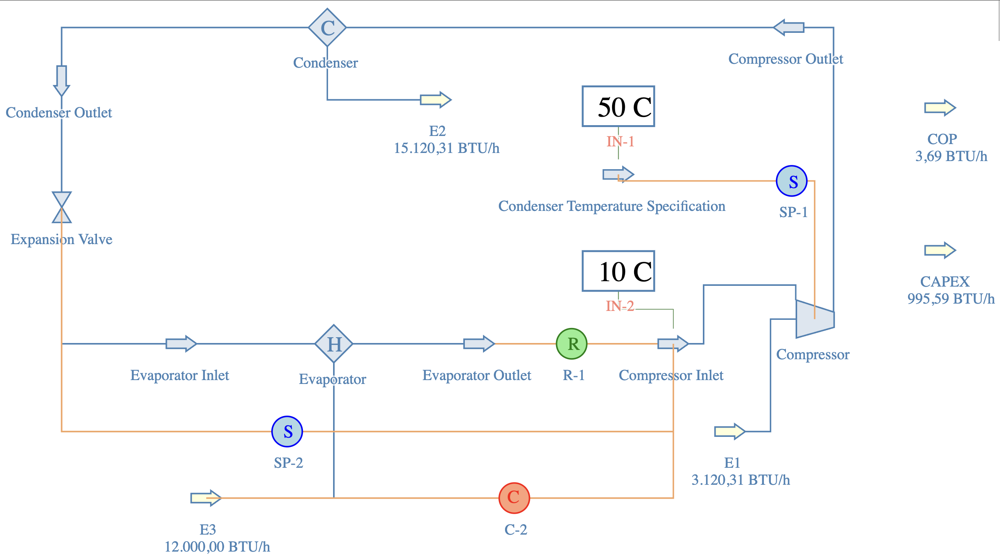<figcaption>Air cooling system (DWSIM)</figcaption></figure>
</div>


<div class="takeaway">Built and used by groups at WVU, CMU, universities in Brazil and across the world.</div>

---

<!-- _class: divider -->

# 1. Dynamic operability

Reachable-output funnels and the dynamic Operability Index

---

# From steady state to dynamics

Steady-state operability asks whether the desired outputs are reachable at all. Dynamic operability asks whether they are reachable within a finite number of steps, and how fast.

For $x_{k+1} = f(x_k, u_k)$, $\; y_k = g(x_k)$, the achievable output set at step $k$ is

$$\mathrm{AOS}^{k}(x_0) = \big\{\, y_k = g(x_k) \;\big|\; u_j \in \mathrm{AIS},\ j = 0,\dots,k-1 \,\big\}, \qquad \mathrm{dOI}(k) = \frac{\mu\!\left(\mathrm{AOS}^{k} \cap \mathrm{DOS}\right)}{\mu(\mathrm{DOS})} \times 100\%$$

<div class="takeaway">Takeaway: Opyrability can now measure how operable a system is as it evolves in time, not only at steady state.</div>

---

# One call

<div class="columns wide-left">
<div class="anim">

```python
from opyrability import dynamic_operability
import numpy as np

AIS = [[-1, 1], [-1, 1]]
DOS = [[-2, 2], [-2, 2]]
model = {'A': 0.9*np.eye(2),
         'B': np.eye(2),
         'C': np.eye(2)}

results = dynamic_operability(model,           # LTI dict or step fn
                              x0=np.zeros(2),  # initial state
                              AIS_bound=AIS,   # input set
                              DOS=DOS,         # target outputs
                              k_max=4)         # horizon
print(results['dOI'])  # [25. 90.25 100. 100.]
```

</div>
<div>

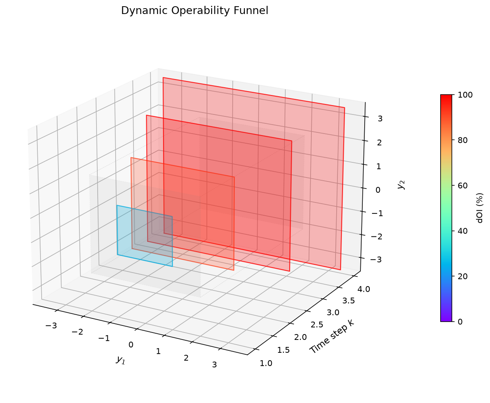

</div>
</div>

---

# Example: membrane reactor for methane aromatization

<div class="columns wide-left">
<div>


</div>
<div>

Upgrade methane to benzene and hydrogen; the membrane pulls $\mathrm{H_2}$ out to push conversion past equilibrium.

$$2\,\mathrm{CH_4} \rightleftharpoons \mathrm{C_2H_4} + 2\,\mathrm{H_2}$$
$$3\,\mathrm{C_2H_4} \rightleftharpoons \mathrm{C_6H_6} + 3\,\mathrm{H_2}$$

<div class="defs"><b>AIS</b>: tube and shell flowrates &middot; <b>DOS</b>: benzene and H<sub>2</sub> mole fractions &middot; <b>AOS</b>: what the reactor can actually reach</div>

</div>
</div>

---

# PDE, distributed model

Transient mole balances on the molar holdups of each species (tube and shell) along the reactor length. Two equilibrium-limited reactions, with membrane $\mathrm{H_2}$ removal shifting them forward (Le Chatelier):

$$r_1 = -(1-v_b)\,\eta\,k_1\,C_{\mathrm{CH_4}}\,\frac{K_1 C_{\mathrm{CH_4}}^{2} - C_{\mathrm{C_2H_4}} C_{\mathrm{H_2}}^{2}}{K_1 C_{\mathrm{CH_4}}^{2}}, \qquad r_2 = -(1-v_b)\,\eta\,k_2\,C_{\mathrm{C_2H_4}}\,\frac{K_2 C_{\mathrm{C_2H_4}}^{3} - C_{\mathrm{C_6H_6}} C_{\mathrm{H_2}}^{3}}{K_2 C_{\mathrm{C_2H_4}}^{3}}$$

$$J_j = \frac{36\,Q}{\alpha_j}\,\pi D_t\,\Delta z \left( P_{t,j}^{1/4} - P_{s,j}^{1/4} \right) \qquad \text{Sieverts-type membrane permeation}$$

Discretized into $N=20$ elements, 4 tube + 4 shell species: a 160-state model. Opyrability needs only a one-minute step, `dma_mr_cocurrent_step(x, u, d)` returning `(x_next, y)`.

<div class="sub"><a href="https://codes-group.github.io/opyrability/examples_gallery/dynamic_dma_mr.html">Full model and dynamic example in the documentation.</a></div>

---

# Reachable-output funnel (interactive)

<iframe class="anim" src="assets/dma_mr_funnel_interactive.html?v=7" width="100%" height="470" style="border:0;border-radius:6px;"></iframe>

<div class="defs"><b>AOS</b> per minute (benzene and H<sub>2</sub>) with Monte Carlo trajectories, scored against the <b>DOS</b>; color shows the dynamic OI (%). Drag to rotate &middot; <a href="assets/dma_mr_funnel_interactive.html?v=7" target="_blank">open full screen</a></div>

---

# HYPER: a cyber-physical fuel-cell and gas-turbine system

<div class="columns">
<div>

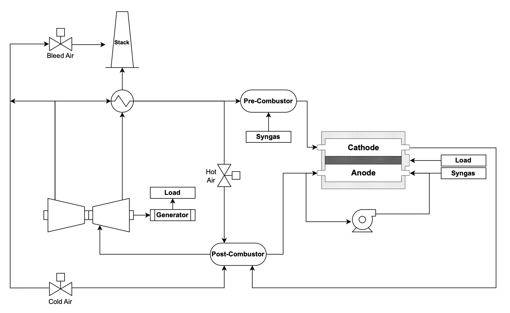

<div class="defs"><b>AIS</b>: electricity load, cold-air bypass &middot; <b>DOS</b>: turbine speed, cathode airflow</div>

</div>
<div>

Identified $2\times2$ first-order model:

$$G(s) = \begin{bmatrix} \dfrac{-0.25}{s+0.225} & \dfrac{-0.065}{s+0.125} \\[1em] \dfrac{-0.22}{s+0.69} & \dfrac{-1.43}{s+1.43} \end{bmatrix}$$

ZOH-discretized ($T_s=1$ min) to a four-state $x_{k+1}=Ax_k+Bu_k$.

<div class="sub">Schematic, model and equations from San Dinh's <a href="https://researchrepository.wvu.edu/etd/11792/">PhD dissertation (WVU)</a>.</div>

</div>
</div>

---

# HYPER: reachable-output funnel (interactive)

<iframe class="anim" src="assets/hyper_funnel_interactive.html?v=7" width="100%" height="470" style="border:0;border-radius:6px;"></iframe>

<div class="defs"><b>AOS</b> per minute (turbine speed and cathode airflow) over 20 minutes, scored against the <b>DOS</b>; color shows the dynamic OI (%). Drag to rotate &middot; <a href="assets/hyper_funnel_interactive.html?v=7" target="_blank">open full screen</a></div>

---

# Choosing a dOI evaluation?

<div class="columns wide-left">
<div>


<div class="sub">Membrane-reactor funnel by three methods.</div>

</div>
<div>

Same funnel, three ways to compute it:

- **exact linear projection** for LTI systems (Minkowski sums, affine maps)
- **nonlinear vertex projection** in state space
- **n-step simulation** for any model

`dynamic_operability` picks one by state dimension and model type, or you force it with `method=`.

</div>
</div>

---

# Disturbance scenarios and robust operability

<div class="columns wide-right">
<div class="tight">

Build one funnel per distrubance scenario, then take their **intersection**: the outputs guaranteed reachable no matter which disturbance hits the process.

```python
scenario_results = dynamic_operability_scenarios(
    make_step,            # step(x, u) for a feed d
    make_initial_state,   # steady state for feed d
    AIS_bounds,
    scenarios={'Low quality well (92% CH4)':  92.0,
               'High quality well (96% CH4)': 96.0},
    DOS=DOS_bounds, k_max=6, engine='plotly')
```

Empty for two minutes, then the robust region grows: adjusting inlet flowrates compensates for feed quality.

<div class="sub"><a href="https://codes-group.github.io/opyrability/examples_gallery/dynamic_dma_mr.html">DMA-MR dynamic example</a></div>

</div>
<div>

<iframe class="anim" src="assets/dma_mr_scenarios_interactive.html?v=2" width="100%" height="500" style="border:0;border-radius:6px;"></iframe>
<div class="sub">Two scenario funnels and their robust intersection (blue). Drag to rotate.</div>

</div>
</div>

---

# HYPER under disturbance scenarios (interactive)

<iframe class="anim" src="assets/hyper_scenarios_interactive.html?v=3" width="100%" height="470" style="border:0;border-radius:6px;"></iframe>

<div class="defs">Each colored outline is one of the four corner disturbances (fuel valve and hot-air bypass at their 95% bounds); the blue <b>intersection</b> is the region reachable under all of them, and it grows as the inputs act. Drag to rotate &middot; <a href="https://codes-group.github.io/opyrability/examples_gallery/dynamic_hyper.html">HYPER dynamic example</a></div>

---

<!-- _class: divider -->

# 2. One command to install

---

# Install and go

Before, running the inverse mapping meant installing IPOPT through conda first.

Now, one command:

```bash
pip install opyrability
```

**That is it.** It includes everything you need, the solver included. `cyipopt` stays optional, only for `method='ipopt'`.

---

# Powered by Pounce

<div style="display:flex;gap:60px;align-items:center;justify-content:center;margin:6px 0 20px;">
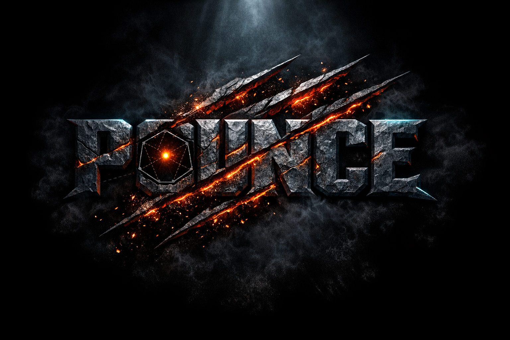
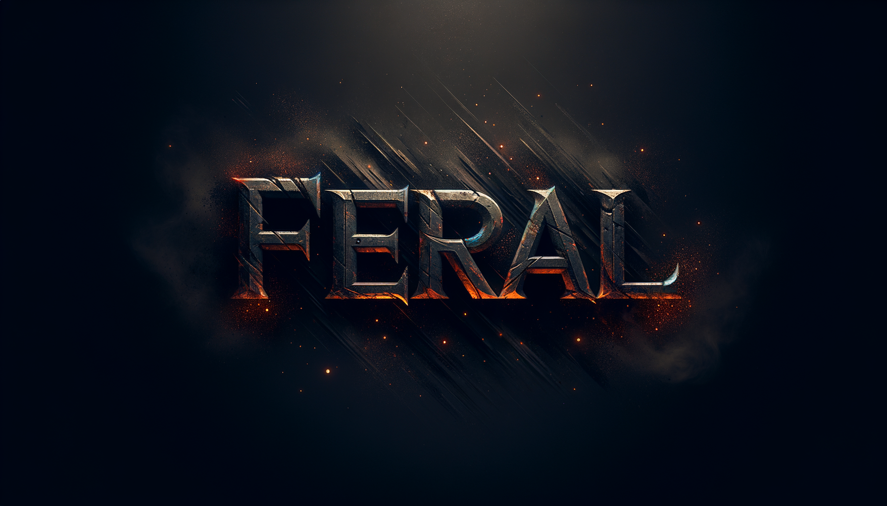
</div>

**Pounce** is a pure-Rust interior-point NLP solver from **John Kitchin**'s group at CMU, now the default for Opyrability's inverse mapping and design tools. Why is this important?

- installs as prebuilt **wheels**: nothing to compile, no third-party binaries, no MUMPS, no licensed HSL to track down
- bundles **FERAL**, its own sparse symmetric-indefinite linear solver with certified inertia, so the interior-point steps stay reliable without an external solver
- one `pip install` gives a fast, self-contained solver on Windows, macOS, and Linux

<div class="sub">kitchingroup.cheme.cmu.edu/pounce</div>

---

# Pounce in action

<div class="columns wide-left">
<div>

Pounce is the default, so nothing changes in your call:

```python
fDIS, fDOS, msg = nlp_based_approach(model,        # process model
                                     DOS,          # target outputs
                                     resolution,   # grid density
                                     u0,           # initial guess
                                     lb, ub)       # input bounds
# method='pounce' by default; 'ipopt' still available
```

</div>
<div>


</div>
</div>

---

<!-- _class: divider -->

# 3. Design decisions

---

# Rank competing designs

Score two or more designs by their Operability Index, from the output or the input side, and see which is more operable before committing.

<div class="columns wide-left">
<div>

```python
from opyrability import rank_designs

ranking = rank_designs(models={'Tall':    model_a,   # {label: model}
                               'Compact': model_b},
                       AIS_bound=AIS,                 # input set(s)
                       DOS_bound=DOS,                 # target outputs
                       resolution=[10, 10],           # grid density
                       perspective='outputs')         # or 'inputs'
```

</div>
<div>

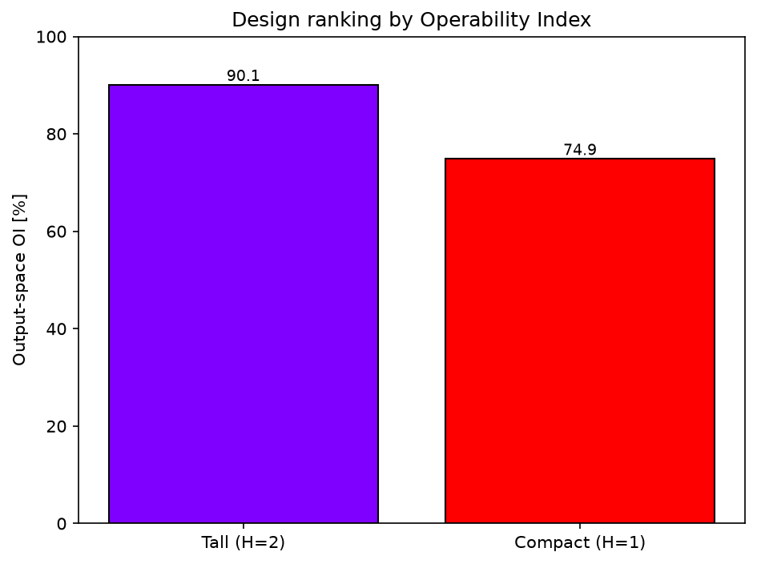

</div>
</div>

---

# Inverse mapping and intensification (NLP)

<div class="columns">
<div>

$$\text{(P1)}\ \min_{u^*_k}\ \sum_{j=1}^{n}\!\Big(\tfrac{y_{j,k}-y^*_{j,k}}{y_{j,k}}\Big)^{2}\ \ \text{s.t. }M,\ u^{\min}\!\le u^*_k\!\le u^{\max}$$
<div class="sub">P1: feasible inputs for the target (the DIS)</div>

$$\text{(P2)}\ \min_{u^*}\ \mathrm{PI}(u^*)\ \ \text{s.t. }u^*\in DIS_{\mathrm{PI}},\ y^*\in DOS_{\mathrm{PI}}$$
<div class="sub">P2: intensify by a metric PI over the feasible set</div>

$$\text{(P3)}\ \min_{u\in\mathbb{U}}\ \mathrm{PI}(u)\ \ \text{s.t. }u^*_k\in\!\!\operatorname*{arg\,min}_{u^*_k\in\mathbb{U}_k,\,y_k\in DOS}\!\text{(P1)}$$
<div class="sub">P3: bilevel; same design as P1 then P2</div>

<div class="sub">Formulations: <a href="https://codes-group.github.io/opyrability/algorithms.html#process-intensification-p2">P2</a> &middot; <a href="https://codes-group.github.io/opyrability/algorithms.html#bilevel-formulation-p3">P3</a> in the documentation.</div>

</div>
<div class="anim">

```python
fDIS, fDOS, msg = nlp_based_approach(
    model,                # process model
    DOS,                  # target outputs
    resolution,           # grid density
    u0, lb, ub,           # guess, bounds
    problem='P2',         # 'P1' / 'P2' / 'P3'
    PI_target=objective)  # metric to intensify
```

<div class="takeaway">Push a design toward a tighter operating point, not just check that it works.</div>

</div>
</div>

---

# Optimal modular design (MILP)

<div class="columns">
<div>

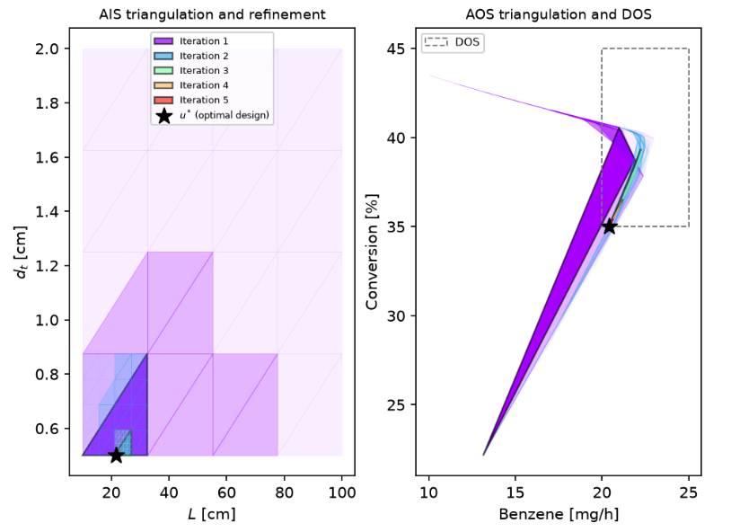

</div>
<div>

The multimodel polytopes turn the search for an optimal modular design into a single mixed-integer linear program, solved once per layer instead of many nonlinear solves.

```python
u_opt, y_opt, phi, *_ = milp_based_approach(
    model,             # process model
    AIS_bound=AIS,     # input bounds
    PI_target=cost,    # metric to minimize
    DOS_bounds=DOS,    # target outputs
    AIS_resolution=5)  # grid density
```

<div class="takeaway">One LP per layer, not many nonlinear solves: fast and mixed-integer linear.</div>

<div class="sub"><a href="https://codes-group.github.io/opyrability/algorithms.html#milp-based-multilayer-framework">MILP framework in the documentation</a></div>

</div>
</div>

---

<!-- _class: divider -->

# 4. Model-agnostic mapping

---

# First-principles, process simulator, algebraic/equation-oriented, and/or ML surrogate

<div class="columns wide-right">
<div>

Opyrability maps whatever you can evaluate:

- a plain **Python** function
- an equation-oriented **Pyomo** model
- a data-driven/ML **surrogate** (scikit-learn)

The plots show operability analyses from several modeling environments, all through the same API.

<div class="chain">
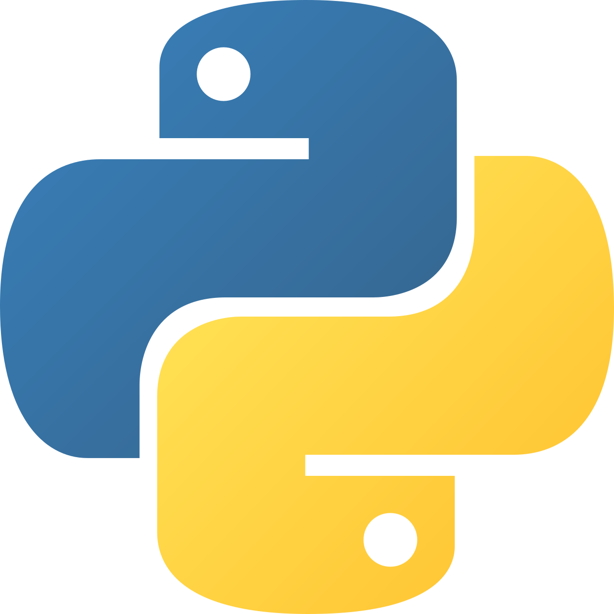
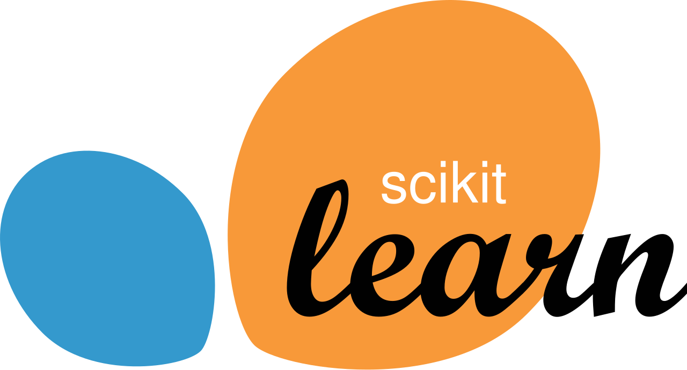

</div>

</div>
<div>

<div class="grid" style="grid-template-columns:1fr 1fr;">
<figure>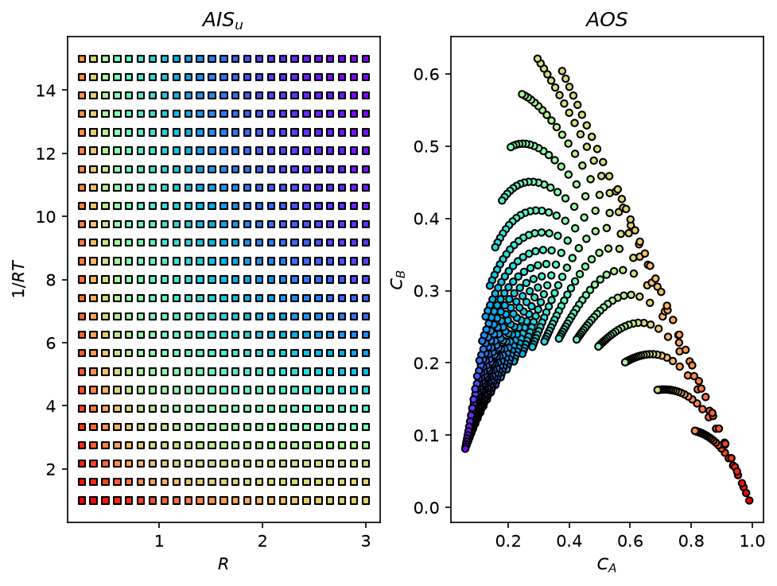<figcaption>Pyomo model</figcaption></figure>
<figure><figcaption>Python function</figcaption></figure>
<figure>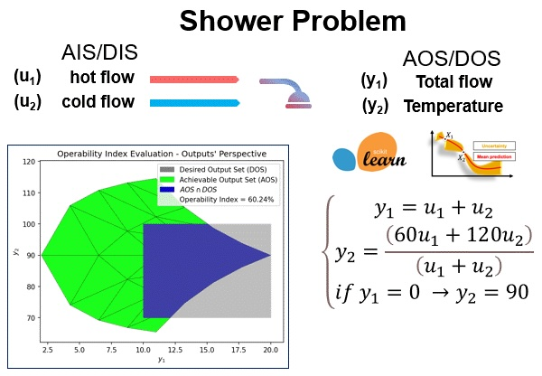<figcaption>GP surrogate</figcaption></figure>
<figure><figcaption>Design ranking (maybe multiple models?!)</figcaption></figure>
</div>

</div>
</div>

---

# ML surrogates under uncertainty

<div class="columns wide-right">
<div>

Fit a Gaussian process surrogate, then propagate its uncertainty through the dynamic analysis.

For a CSTR under a GP-NARX surrogate:

$$\mathrm{dOI} = 45.3\%$$
<div class="sub">+3&sigma;: 51.7%, &minus;3&sigma;: 38.5%.</div>

<div class="defs"><b>AOS</b> is now a distribution; the mean and plus/minus three sigma funnels bound it.</div>

</div>
<div>

<iframe class="anim" src="assets/gp_narx_funnel_interactive.html?v=7" width="100%" height="450" style="border:0;border-radius:6px;"></iframe>
<div class="sub">Drag to rotate &middot; <a href="assets/gp_narx_funnel_interactive.html" target="_blank">open full screen</a></div>

</div>
</div>

---

<!-- _class: divider -->

# 5. LLM and coding agent integration

---

# Drive it with your coding agent

Opyrability ships with **`OPYRABILITY.md`**: one file that teaches an AI coding assistant the vocabulary, function signatures and best practices, the expected model (M) syntax, when to use each function, and the mistakes to avoid.

<div class="chain" style="gap:22px;margin-top:30px;">
<span style="font-size:70px;">&#129489;&#8205;&#128187;</span>
<span style="font-size:48px;">&#128172;</span>
<span class="a">&#8594;</span>
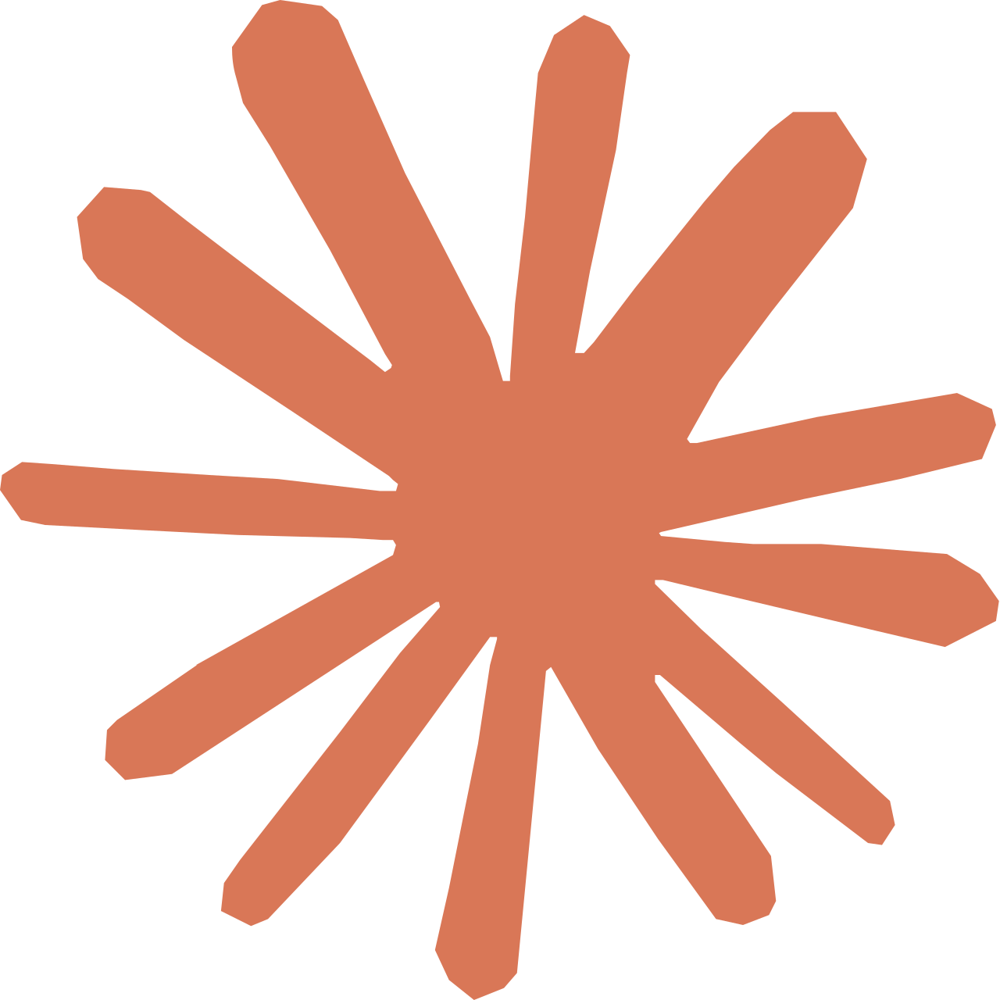

<span class="a">&#8594;</span>
<span class="code" style="font-size:34px;">&lt;/&gt;</span>
<span class="a">&#8594;</span>

<span class="a">&#8594;</span>

<span class="a">&#8594;</span>
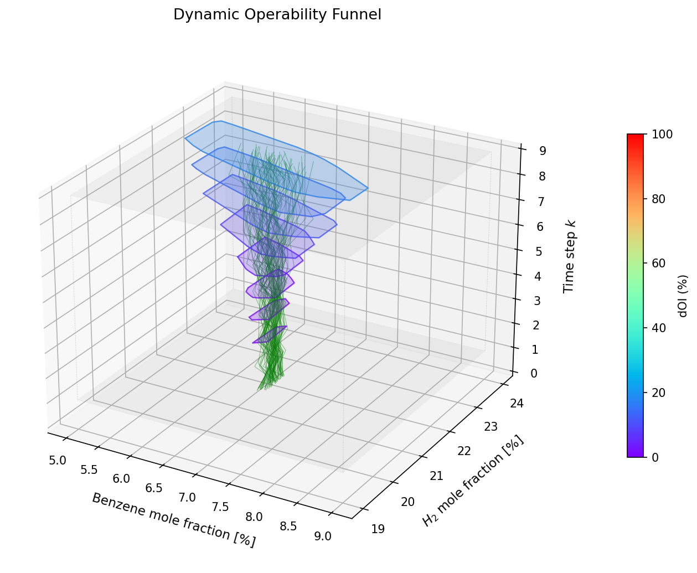
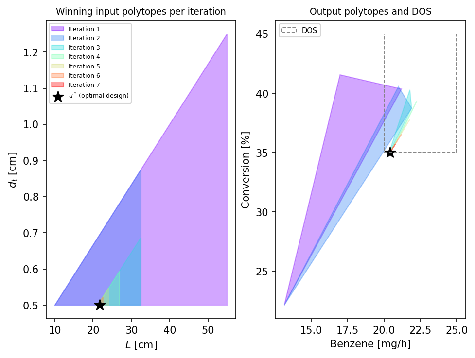
</div>

<div class="sub" style="margin-top:14px;">You ask; Claude Code, Codex, or Copilot reads <code>OPYRABILITY.md</code>, writes the model, and runs the operability analysis, from inverse maps to intensified designs.</div>

---

<!-- _class: divider -->

# 6. Documentation and testing

---

# Documentation

<div class="columns wide-right">
<div>

- every function in the API reference ships with a **runnable example**
- a **gallery** of worked case studies, from the shower problem to membrane reactors
- a **new section** on the dynamic methods

Read the [documentation](https://codes-group.github.io/opyrability/) and the [operability fundamentals](https://codes-group.github.io/opyrability/operability_overview.html).

</div>
<div>

```python
# every API page runs code like this
from opyrability import (
    multimodel_rep, OI_eval)

AOS = multimodel_rep(model, AIS,
                     resolution=[10, 10])
OI = OI_eval(AOS, DOS)   # -> 60.2 %
```

</div>
</div>

---

# Tested across multiple Python versions (3.11 - 3.14)

<div class="columns">
<div>

<span class="bignum">147</span>
<div class="sub">automated tests, significantly more when compared to the previous version 1.4.9</div>

</div>
<div>

Run in continuous integration on Python 3.11, 3.12, 3.13, and 3.14, and on every pull request. They cover:

- dynamic operability and funnels
- design ranking and MILP design
- Pyomo and implicit mapping
- polytope geometry

</div>
</div>

---

# Contributing

Opyrability is open source and welcomes contributions. It will always be that way.

- **Report a bug or request a feature**: [open an issue on GitHub](https://github.com/CODES-group/opyrability/issues)
- **Contribute code or a case study**: [fork the repo](https://github.com/CODES-group/opyrability), branch, and open a pull request
- CI runs the full test suite on your pull request across Python 3.11 to 3.14

<div class="sub">github.com/CODES-group/opyrability</div>

---

# Upgrading from 1.4.x

- the default solver is now Pounce; for the IPOPT backend, pass `method='ipopt'` and install `cyipopt` from conda
- Python 3.9 and 3.10 are no longer supported (both reached EOL); the minimum is 3.11
- the conda package is retired; install with pip

---

# Opyrability 2.0 at a glance

<div class="columns">
<div>

1. **Dynamic operability**: funnels + dOI, one call
2. **Pounce** default solver, pure pip install
3. **rank designs**, **MILP based approach**
4. **P1 / P2 / P3** inverse mapping s.t. PI
5. **Pyomo** and ML surrogate models support
6. **`OPYRABILITY.md`** agent skill
7. **147 tests**, Python 3.11 to 3.14

[Docs](https://codes-group.github.io/opyrability/) &middot; [Code](https://github.com/CODES-group/opyrability) &middot; [Paper](https://doi.org/10.21105/joss.05966)

</div>
<div>

<div class="grid anim" style="grid-template-columns:1fr 1fr;">
<figure></figure>
<figure></figure>
<figure></figure>
<figure></figure>
</div>

</div>
</div>

<div class="anim">

```bash
pip install opyrability
```

</div>

---

# Thanks

Development began in the CODES Group at West Virginia University, with **San Dinh** and under **Fernando V. Lima**, and continues at Carnegie Mellon University. **Pounce** is the work of **John Kitchin** and his group.

<div style="display:flex;gap:72px;align-items:center;justify-content:center;margin-top:44px;">


</div>

<div class="sub" style="text-align:center;margin-top:30px;"><a href="https://victor-alves.com">victor-alves.com</a></div>
