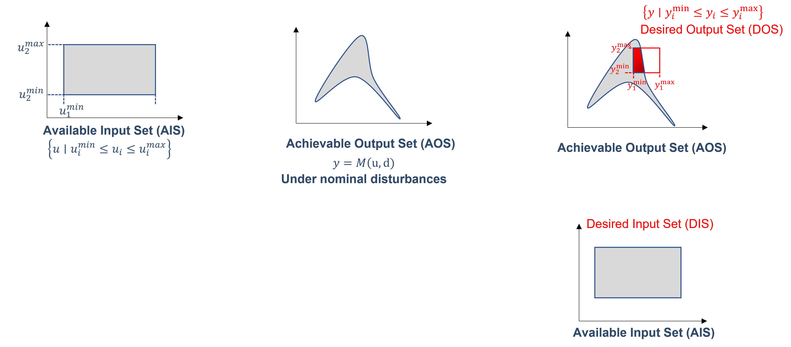
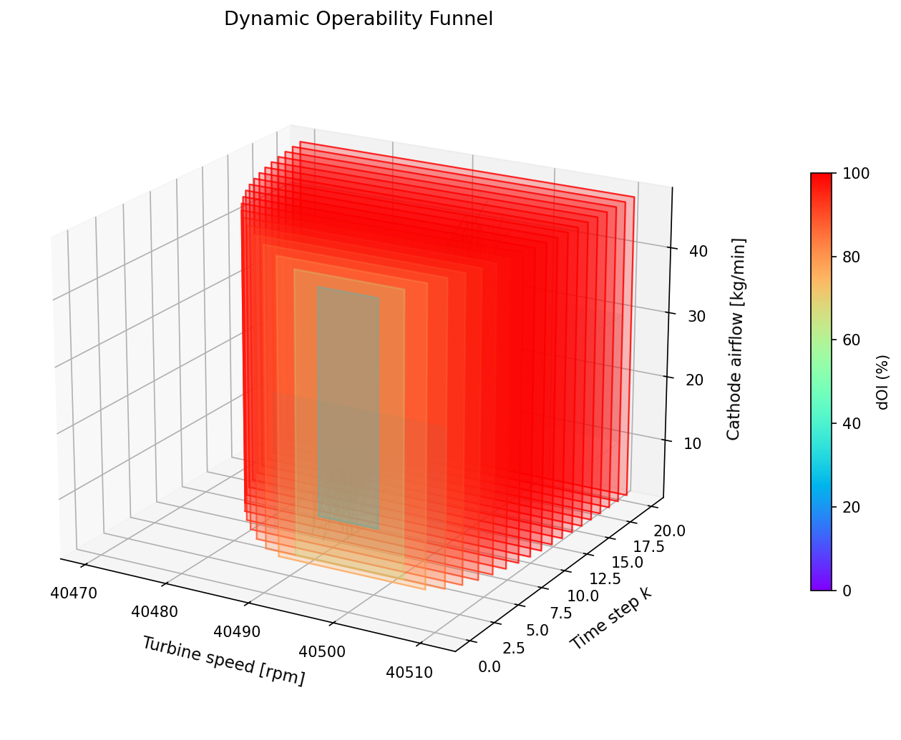
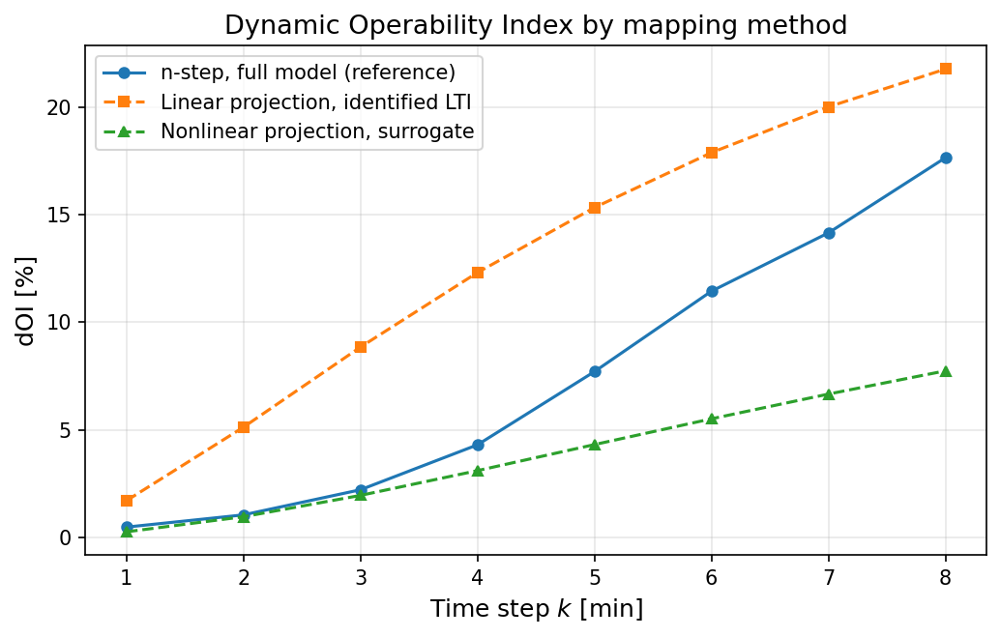
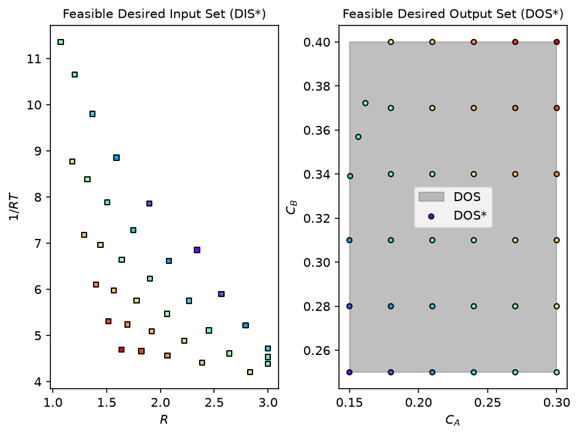
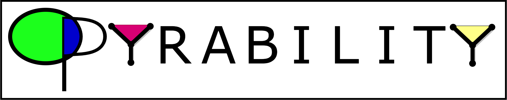
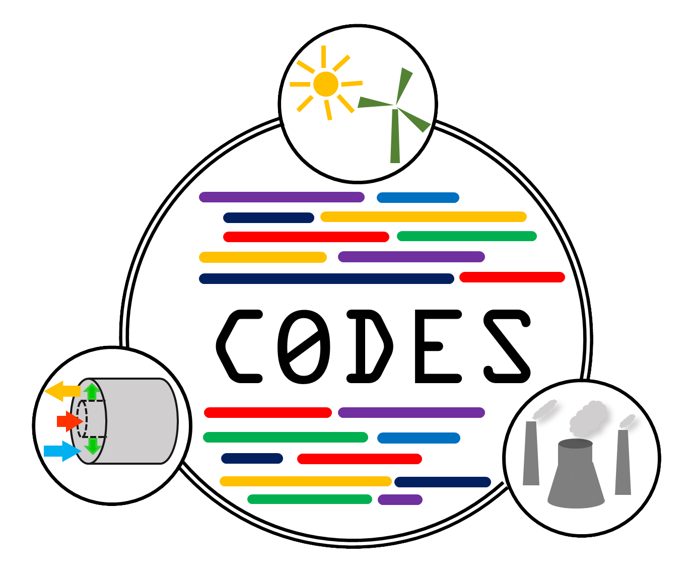

<!-- _class: lead -->
<!-- _paginate: false -->
<!-- _footer: '' -->

# opyrability 2.0

## Process operability analysis in Python, now with dynamics

Victor Alves
Carnegie Mellon University

July 2026

---

# What is opyrability?

A Python package for **process operability analysis**. Given the inputs you can manipulate, it maps the outputs a process can reach, scores how well it can hit the targets you want (the Operability Index), and inverts those targets back to feasible inputs and designs.



---

<!-- _class: invert -->

# Where opyrability stands

<div class="columns">
<div>

<span class="bignum">36k+</span>
<div class="sub">downloads in about two years</div>

</div>
<div>

It started as part of my PhD research. It is now used by researchers and students across the northern and southern hemispheres to do their own work.

2.0 is the largest release so far.

</div>
</div>

---

# What is new in 2.0

- **Operability over time**: reachable-output funnels and a dynamic index
- **One command to install**: `pip install opyrability`, solver included
- **Better design decisions**: rank designs, optimal design, intensification
- **Bring your own model**: Python functions, Pyomo, and surrogates
- **Built for how people work**: an agent guide for LLM-assisted use
- **A solid foundation**: documented, and tested on Python 3.11 to 3.14

---

<!-- _class: divider -->

# 1. Operability over time

Reachable-output funnels and the dynamic Operability Index

---

# From steady state to dynamics

Steady-state operability asks: *can the process reach the outputs we want?*

Version 2.0 asks a harder question: *can it get there within a finite number of steps, and how fast?*

The answer is the **funnel**: the set of outputs reachable at each step. Score the funnel against your target at every step and you get the **dynamic Operability Index (dOI)**.

---

# One call

```python
from opyrability import dynamic_operability
import numpy as np

model = {'A': 0.9 * np.eye(2), 'B': np.eye(2), 'C': np.eye(2)}

res = dynamic_operability(model,
                          x0=np.zeros(2),
                          AIS_bound=np.array([[-1.0, 1.0], [-1.0, 1.0]]),
                          DOS=np.array([[-2.0, 2.0], [-2.0, 2.0]]),
                          k_max=4)

print(res['dOI'])      # [25.  90.25  100.  100.]
```

One function builds the funnel, scores the dOI at each step, and plots it. It picks the method for you: an exact calculation for linear systems, simulation for nonlinear ones.

---

# Example: a membrane reactor

<div class="columns wide-right">
<div>

A membrane reactor for methane aromatization and hydrogen production.

The funnel shows which outputs become reachable as time steps forward, and the step at which the target comes into reach.

</div>
<div>


</div>
</div>

---

# A real cyber-physical system

<div class="columns wide-right">
<div>

HYPER: a solid oxide fuel cell coupled to a gas turbine.

This is a real hardware-in-the-loop facility, and the same dynamic analysis applies to it.

</div>
<div>



</div>
</div>

---

# Method choice, and uncertainty

<div class="columns wide-left">
<div>



</div>
<div>

Trade fidelity against cost: exact linear projection, nonlinear projection, or n-step simulation.

Handle uncertainty too:
- funnels across disturbance scenarios
- Monte Carlo trajectory overlays
- funnels under Gaussian noise
- a linear model built from step tests

</div>
</div>

<div class="sub">Based on Dinh and Lima, 2023 and 2026.</div>

---

<!-- _class: divider -->

# 2. One command to install

---

# Install and go

Before, running the inverse mapping meant installing IPOPT through conda first.

Now:

```bash
pip install opyrability
```

That is the whole setup. The solver comes with it. `cyipopt` is now optional, needed only for `method='ipopt'`.

---

# Powered by Pounce

<div class="columns">
<div>

The default solver is now **Pounce**: a pure-Rust solver in the IPOPT family, with its own bundled linear solver, shipped as prebuilt wheels.

That is what lets `pip install opyrability` stand on its own, and it is fast.

</div>
<div>

Built by **John Kitchin** and his group at Carnegie Mellon University.

<div class="sub">kitchingroup.cheme.cmu.edu/pounce</div>

</div>
</div>

---

# Pounce in action



Inverse mapping a desired output region back to the inputs that reach it, solved with Pounce.

---

<!-- _class: divider -->

# 3. Better design decisions

---

# Rank competing designs

<div class="columns wide-right">
<div>

```python
from opyrability import rank_designs

ranking = rank_designs(
    {'Tall reactor': model_a,
     'Compact reactor': model_b},
    AIS_bound=AIS,
    DOS_bound=DOS,
    resolution=[10, 10],
    perspective='outputs')
```

Score two or more designs by their Operability Index and see which one wins, before you commit to it.

</div>
<div>


</div>
</div>

---

# Optimal and intensified design

<div class="columns wide-left">
<div>


</div>
<div>

Search directly for an optimal modular design with `milp_based_approach()`.

Push a design toward a tighter operating point with the intensification modes of `nlp_based_approach()`.

Same performance, smaller footprint.

</div>
</div>

---

<!-- _class: divider -->

# 4. Bring your own model

---

# Any model fits

<div class="columns wide-right">
<div>

opyrability maps whatever you can evaluate:

- a plain Python function
- an equation-oriented **Pyomo** model
- a data-driven surrogate

The figure comes from a Pyomo model, mapped the same way a Python function would be.

</div>
<div>


</div>
</div>

---

# Surrogates in practice

<div class="columns wide-left">
<div>


</div>
<div>

When a first-principles model is expensive, fit a surrogate and run operability on that instead.

This map uses a Gaussian process surrogate of a shower system, contributed by a user.

</div>
</div>

---

<!-- _class: divider -->

# 5. Built for how people work

---

# Drive it with your coding agent

opyrability ships with **`OPYRABILITY.md`**, one file that teaches an AI coding assistant how to use the package correctly.

Point Claude Code, Cursor, or Copilot at it and ask for an analysis. It covers:

- the operability vocabulary and the model contract
- when to use each function
- copy-paste recipes and the common mistakes to avoid

You get correct results without reading the source first.

---

<!-- _class: divider -->

# 6. A solid foundation

---

# Documented

- every function in the API reference has a runnable example
- a gallery of worked case studies, from the shower problem to membrane reactors
- a new section that explains the dynamic methods from the start

---

<!-- _class: invert -->

# Well tested

<div class="columns">
<div>

<span class="bignum">147</span>
<div class="sub">automated tests, up from 4 in version 1.4.9</div>

</div>
<div>

Run in continuous integration on Python **3.11, 3.12, 3.13, and 3.14**.

They cover the new dynamic, design-ranking, optimal-design, Pyomo, implicit-mapping, and geometry code paths.

</div>
</div>

---

# Upgrading from 1.4.x

- the default solver is now Pounce; for the IPOPT backend, pass `method='ipopt'` and install `cyipopt` from conda
- Python 3.9 and 3.10 are no longer supported; the minimum is 3.11
- the conda package is retired; install with pip

---

# Try it

```bash
pip install opyrability
```

- Docs and examples: codes-group.github.io/opyrability
- Code: github.com/CODES-group/opyrability
- Paper (JOSS): doi.org/10.21105/joss.05966

---

# Thanks

Development began in the CODES Group at West Virginia University, with **San Dinh** and under **Fernando V. Lima**. It continues at Carnegie Mellon University.

**Pounce** is the work of **John Kitchin** and his group.

Thanks to the contributors who added case studies and simulator connectors.

 
